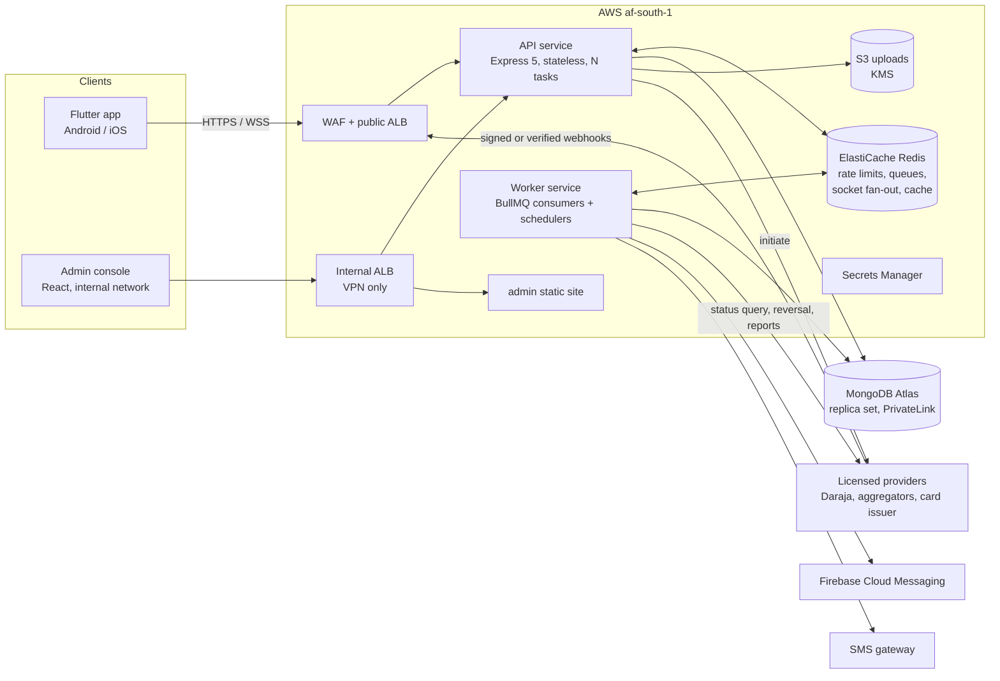
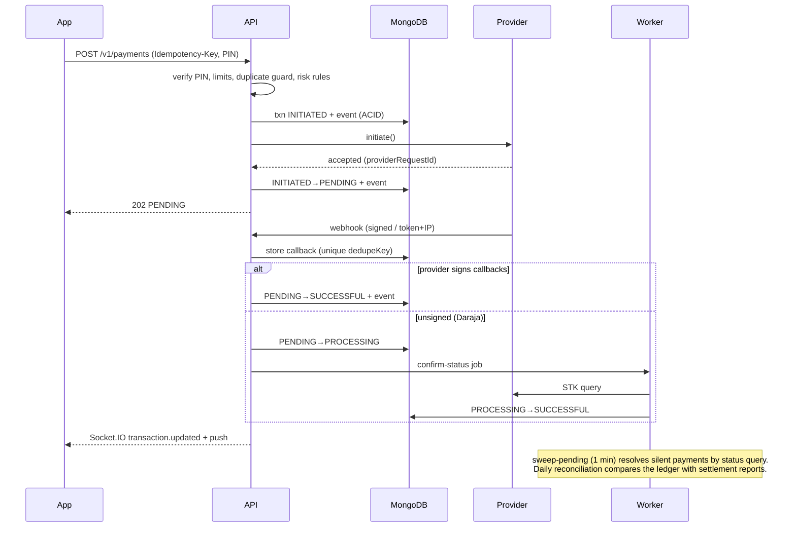

# Architecture

## System context



The API is stateless and scales horizontally. Sessions live in MongoDB, revocations in Redis, and Socket.IO fans out across instances through the Redis adapter. Background work (push delivery, status sweeps, reconciliation, reminders, recurring entries, cashback release, campaign fan-out) runs in the **worker**, a separate service that scales on its own. Every job is idempotent, so retries and duplicate schedules are safe.

## Backend modules (`backend/src/modules`)

| Module | Responsibility |
|---|---|
| `auth` | Registration, OTP (HMAC-hashed, attempt-limited, rate-limited), device-bound login with OTP step-up, rotating refresh tokens with reuse detection, lockouts, transaction PIN, password reset, email verification, account recovery |
| `users` | Profile, preferences, privacy and consents, devices, sessions, limits, KYC submission (AES-GCM encrypted ID numbers), data export, account closure |
| `payments` | Provider abstraction, initiation, the state machine, callbacks, status sweeper, reversals, reconciliation, fees, risk rules |
| `transactions` | Search and filters (cursor pagination), detail with timeline, receipts, recategorisation, streamed CSV and PDF statements |
| `accounts` | Linked accounts (aggregator adapter) and manually tracked accounts, with balance provenance |
| `savings` | Tracking-only goals, atomic contributions, projections, reminders |
| `budgets` | Weekly and monthly budgets, manual expenses and income, recurring items, threshold alerts |
| `analytics` / `insights` | Period summaries and trends; local insight engine (robust outlier detection, patterns, suggestions) with an optional, consent-gated Claude narrative |
| `cards` | Tokenised virtual and linked cards through an issuer adapter, controls, signed issuer webhooks |
| `rewards` | Admin-configured campaigns, dedupe-keyed reward ledger, clawbacks, referrals with abuse checks |
| `notifications` | In-app notifications, FCM push, preferences, Socket.IO events |
| `support` | Tickets, including account-recovery cases |
| `admin` | Admin auth (TOTP MFA), RBAC, operational APIs, maker-checker approvals, notification campaigns |
| `audit` | Hash-chained audit log and security events |

Every route is declared once with `createRouter().route({...})`. That one declaration wires the zod validation (unknown body keys are rejected), the middleware (auth, permissions, rate limits, idempotency) and the OpenAPI document, so the docs can't drift from the code.

## Payment lifecycle



### State machine

```
INITIATED ─┬─> PENDING ─┬─> PROCESSING ─┬─> SUCCESSFUL ──> REVERSED
           │            └───────────────┤
           └────────────────────────────┴─> FAILED
```

`transition()` is the **only** code path that changes a status. Inside a MongoDB transaction it reads the transaction, checks the transition is allowed, applies a compare-and-set update keyed on `status` and `version`, and appends an immutable `TransactionEvent`. A disallowed move (e.g. a late `FAILED` callback after `SUCCESSFUL`) is rejected and logged. If the provider times out the outcome is treated as *unknown*: the transaction stays `PENDING` and is flagged for review, and is never assumed to have failed.

Reconciliation resolves non-terminal transactions to the provider's settlement outcome. It **never** overturns a terminal status. Conflicts go to finance as `STATUS_MISMATCH` or `AMOUNT_MISMATCH` exceptions.

### Provider abstraction

**Routing rule.** Safaricom's STK Push can only collect into the shortcode that owns the passkey, i.e. the licensed partner's own account. The Daraja adapter therefore supports **`DEPOSIT` ("Add money") only**. Paying a *third-party* paybill, till or biller, or sending money to a person, needs an aggregator, B2B or B2C adapter under a partner agreement. Routing those through STK would deliver the customer's money to the wrong recipient. The app shows only the payment types that some live provider supports (`GET /v1/payments/options`), so in production the Pay screen grows as partner adapters are added.

A verified callback can arrive before the payment's `providerRequestId` is written (a race with initiation). It is stored as `ORPHANED` and re-applied by a backoff job (15 s → 4 min). The status sweeper and reconciliation remain as further safety nets.

`PaymentProviderAdapter` (`payments/providers/base.js`) defines the interface every provider implements: `initiate`, `parseCallback`, `queryStatus`, `reverse` and `settlementReport`, plus declared capabilities (types, currencies, countries, signed callbacks, confirm-by-query). Adding a provider means writing one adapter and adding one registry entry. Fees, priority, enablement and maintenance mode live in the `PaymentProvider` collection and are edited from the admin console.

## Country configuration

`backend/src/config/countries/<CC>.js` holds the dial code, currency, locales, timezone, enabled payment types, providers, KYC ID types, tiered limits, billers and regulators. `ENABLED_COUNTRIES` decides which are live. Uganda is pre-configured as an example. Currency precision lives in `config/currencies.js`.

## Mobile architecture (`mobile/lib`)

- `core/`: environment (dart-defines), theme tokens, the Dio `ApiClient` (single-flight refresh and an idempotency-key policy), secure storage, biometrics, Socket.IO, FCM, the router.
- `features/<feature>/{data,ui}`: Freezed models and repositories (`data`) and screens (`ui`), with Riverpod providers.
- Navigation: a GoRouter redirect driven purely by `AuthState` (`AuthUnknown`, `Unauthenticated(pending OTP)`, `Locked`, `Authenticated`), and a `StatefulShellRoute` for the five tabs.
- Security: tokens only in the Keystore/Keychain; the app auto-locks after 2 minutes in the background; `FLAG_SECURE`; backups disabled; HTTPS-only release builds.

## Scalability

- Cursor pagination over `(createdAt, _id)` compound indexes everywhere; no skip/offset.
- Statements stream from a MongoDB cursor, so a user's full history is never loaded into memory.
- Distributed rate limits in Redis, with an in-memory insurance limiter if Redis is briefly unavailable.
- Socket.IO uses the Redis adapter, and workers emit through the Redis emitter.
- ECS autoscaling on CPU. MongoDB and Redis pool sizes are configured. Indexes are built at release time, not under live traffic.
